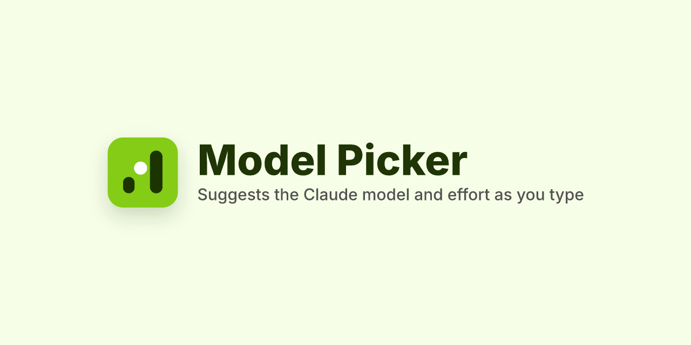

  
  <h1>Model Picker</h1>
  
Suggests which Claude model and effort level fit your prompt, before you send it.

## What it does
Model Picker is a Chrome extension for claude.ai. As you draft a prompt, it reads what you are typing and suggests the model and effort level that suit the task. You stay in control and make the final choice.

## Features
- Reads your draft prompt in the composer and suggests a fitting model
- Suggests an effort level to match the task
- Works inline on claude.ai, before you send
- Runs in your browser

## Install
Install from the Chrome Web Store:
https://chromewebstore.google.com/detail/model-picker-model-and-ef/hilolfchpmjmkjfnpjcedfeochdnlddk
What changed in each version is in [CHANGELOG.md](./CHANGELOG.md).

## Support
This repository exists for trust and support. The extension is published on the Chrome Web Store and its source is not public.
Questions and reports are welcome on the issue tracker:
https://github.com/modelpicker/model-picker/issues

## Privacy
Model Picker is built to respect your privacy. Read the full policy:
[PRIVACY.md](./PRIVACY.md)

## Rights
Copyright 2026 Model Picker. All rights reserved. The source code is proprietary and is not licensed for reuse.

---

Model Picker is an independent tool. It is not affiliated with, endorsed by, or sponsored by Anthropic. Claude is a trademark of Anthropic, PBC.
